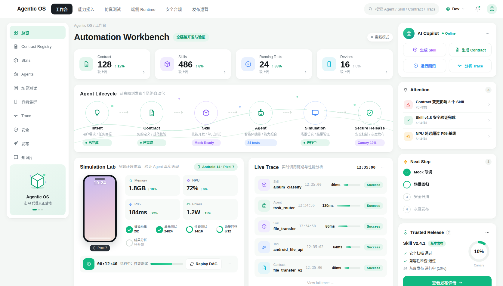
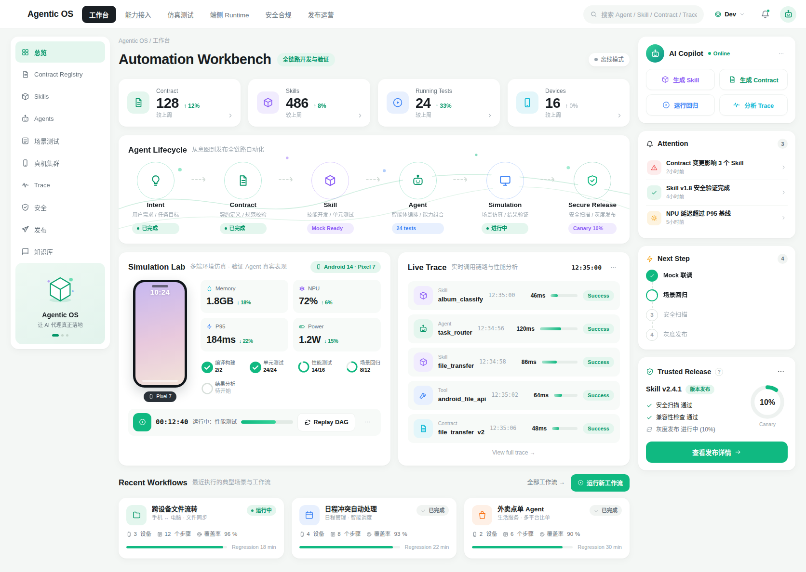
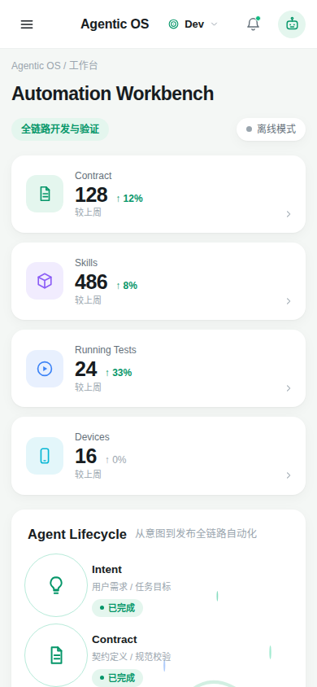

# Agentic OS 自动化开发工作台

> 面向「人 + Agent 协作开发」的个人数字工作台 —— 单文件 HTML 实现，一比一复刻设计稿，PC / 移动端双适配，数据在线同步。

<!-- 本工作台通过 WorkBuddy「资料库」skill 搭建、存储和部署 -->

## 项目简介

本项目旨在解决 Agent 自动化开发中的**七大核心矛盾**（意图模糊 vs 执行精确、上下文膨胀 vs 记忆有限、自由生成 vs 合同约束、单体智能 vs 多智能体协同、模拟环境 vs 真实发布、人机信任鸿沟、迭代速度 vs 质量管控），为用户提供一个可视化的「自动化开发控制中枢」。

工作台按设计稿一比一复刻，覆盖 **总览 Dashboard** 全部功能区，并已按工程化流程完成需求拆解、架构设计、方案设计、复刻实现与 72 项测试用例对比修正的完整闭环。

## 在线访问

| 入口 | 链接 |
|---|---|
| 发布态（免登录分享） | https://workbuddy.link/p/WBUp19xTB5HNld1xCQJ2R3 |
| 编辑态（资料库协作） | https://www.workbuddy.cn/space/d/WBUp19xTB5HNld1xCQJ2R3 |
| 工作流数据表 | https://www.workbuddy.cn/space/d/N3dtSeMOGPwFHfX8C0TFtg |
| Trace 数据表 | https://www.workbuddy.cn/space/d/vyxhkufW37wdSjz8Tv3Zyz |

> 手机浏览器打开发布态链接后，通过「分享 → 添加到主屏幕」可当 APP 使用。

## 功能特性

### 核心模块（对齐设计稿一比一复刻）

- **KPI 指标卡**：Contract 128 / Skills 486 / Running Tests 24 / Devices 16，实时统计与趋势标识
- **Agent Lifecycle 六节点流水线**：Intent → Contract → Skill → Agent → Simulation → Secure Release，含状态高亮与描述断行优化
- **Simulation Lab**：手机模型实时时钟、四项核心指标（成功率 / 延迟 / Token 消耗 / 成本）、任务进度条、Canary 10% 灰度发布控制
- **Live Trace 实时日志**：每 4 秒滚动追加 Span，支持 Replay 重放，含 Span 类型与状态标记
- **Recent Workflows 工作流卡片**：三卡布局，支持新建工作流（弹窗表单，真实写库）
- **AI Copilot 抽屉**：右侧滑出，对话式辅助与快捷指令
- **Attention 异常聚焦 + Next Step 决策卡**：优先级标注与一键处理
- **六大页面 Tab**：总览 / 工作流 / 技能 / 合同 / 设备 / 设置 的顶部导航骨架

### 数据与工程能力

- **在线双向同步**：通过 `window.__SMART_PAGE__.database` SDK 直连资料库双表（工作流表 + Trace 表），页面修改实时落库
- **三级降级链路**：SDK 在线同步 → localStorage 离线缓存 → 内置演示数据，断网不丢数据，右上角同步状态指示器（已同步 / 同步中 / 离线模式）
- **防死循环分页**：startCursor 分页链 + guard ≤100 防护
- **XSS 防护**：全部 11 处动态 innerHTML 经 `sanitizeHtml` 集中通道包裹
- **零依赖**：全内联 CSS/JS/SVG 图标，不引用任何外部框架 / CDN / 字体 / 图表库，离线可用

## 预览

| 桌面总览 | 整页全景 |
|---|---|
|  |  |

| AI Copilot 抽屉 | 移动端适配 |
|---|---|
|  |  |

## 项目结构

```
agentic-os-workbench/
├── workbench.html              # 工作台成品（单文件，约 107KB）
├── README.md
└── docs/
    ├── 01-需求拆解与需求文档.md    # 七大矛盾→能力域映射、FR-1~FR-8 规格
    ├── 02-架构设计.md             # 五层架构、9 模块、函数调用 DAG、双表结构
    ├── 03-方案设计.md             # Design Tokens、逐区域实现规格、DataBridge 方案
    ├── 04-测试用例与对比修正报告.md # 72 用例 7 大类对比结论与 3 轮修正记录
    └── screenshots/              # Playwright 双断面验证截图
```

## 技术架构

五层单向架构，函数调用关系构成有向无环图（DAG），渲染函数零互调，统一由 `refreshAll()` 调度：

```
┌─────────────────────────────────────────────┐
│  视图层    HTML 结构 + 38 个内联 SVG symbol      │
├─────────────────────────────────────────────┤
│  渲染层    render* × 9（只读 state，零互调）      │
├─────────────────────────────────────────────┤
│  状态层    state 单例 + 模拟引擎（3 定时器）       │
│           tickClock 1s / tickTrace 4s / tickProgress 2.5s │
├─────────────────────────────────────────────┤
│  数据接入层 DataBridge（loadWorkflows/loadTraces）│
├─────────────────────────────────────────────┤
│  宿主层    window.__SMART_PAGE__.database SDK   │
│           ↓ 降级                              │
│           localStorage → 内置演示数据            │
└─────────────────────────────────────────────┘
```

**响应式断点**：1672px 标准桌面 / 1200px / 900px / 768px 平板 / 390px 移动端单列，按钮 ≥44px、输入框字号 ≥16px、适配 iPhone 底部安全区。

## 快速开始

### 方式一：直接打开

下载 `workbench.html` 后用浏览器打开即可，离线模式下自动使用内置演示数据。

### 方式二：本地开发

```bash
git clone git@github.com:xiaopengs/agentic-os-workbench.git
cd agentic-os-workbench
python3 -m http.server 8080
# 浏览器访问 http://localhost:8080/workbench.html
```

> 在线同步功能需在 WorkBuddy 资料库环境内运行（页面节点 `WBUp19xTB5HNld1xCQJ2R3` 挂载双表）。

## 测试结论

**72/72 用例全部通过**，运行时 **0 JS 错误**（Playwright 桌面 1672×950 + 移动 390×844 双断面验证）：

| 分类 | 用例数 | 结果 |
|---|---|---|
| A 平台静态规范 | 6 | ✅ 全通过 |
| B 布局还原 | 14 | ✅ 全通过 |
| C 视觉还原（经 3 轮修正） | 18 | ✅ 全通过 |
| D 交互功能 | 12 | ✅ 全通过 |
| E 数据链路（真实写库验证） | 8 | ✅ 全通过 |
| F 响应式 | 6 | ✅ 全通过 |
| G 代码质量（无递归环/全内联） | 8 | ✅ 全通过 |

详见 [docs/04-测试用例与对比修正报告.md](docs/04-测试用例与对比修正报告.md)。

## 路线图

- **Phase 2（3-6 个月）**：接入真实 Agent 运行时，Trace 表切换为真实事件流推送；工作流编排编辑器
- **Phase 3（6-12 个月）**：多设备 Device Farm 管理、权限体系、Trace 回放与回归对比分析

## 许可

私有项目，仅授权账号内使用。
