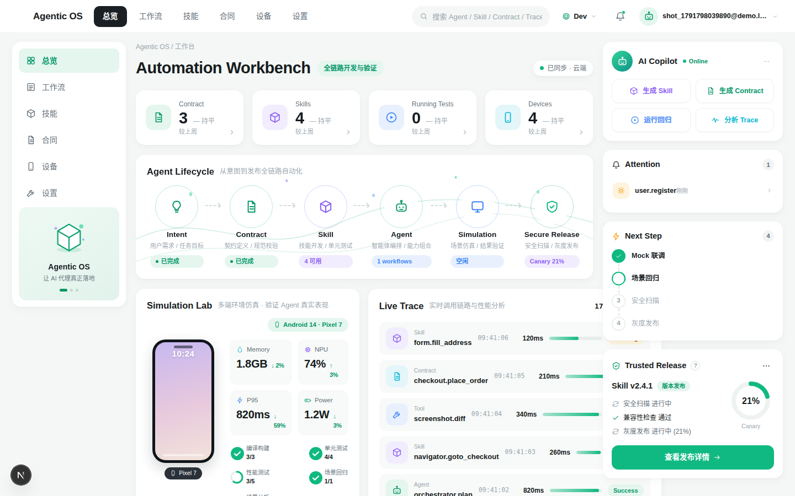
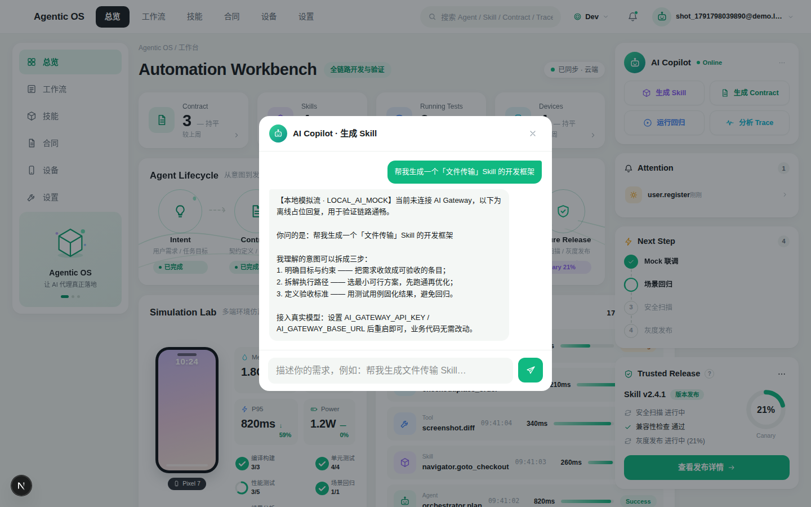
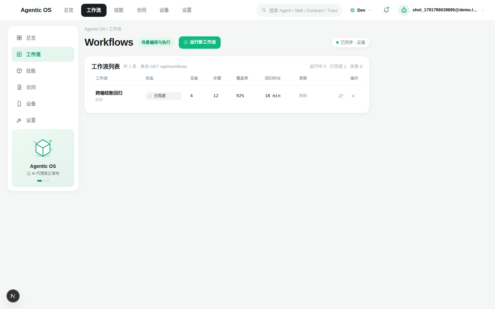
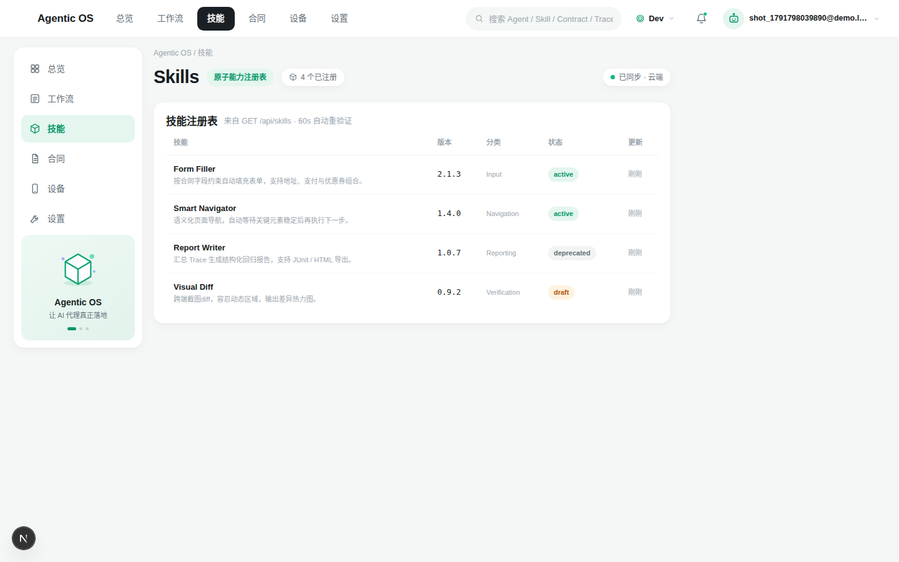
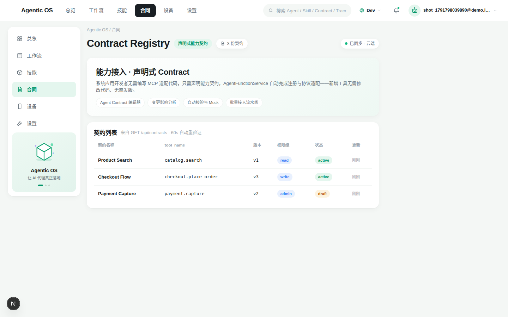
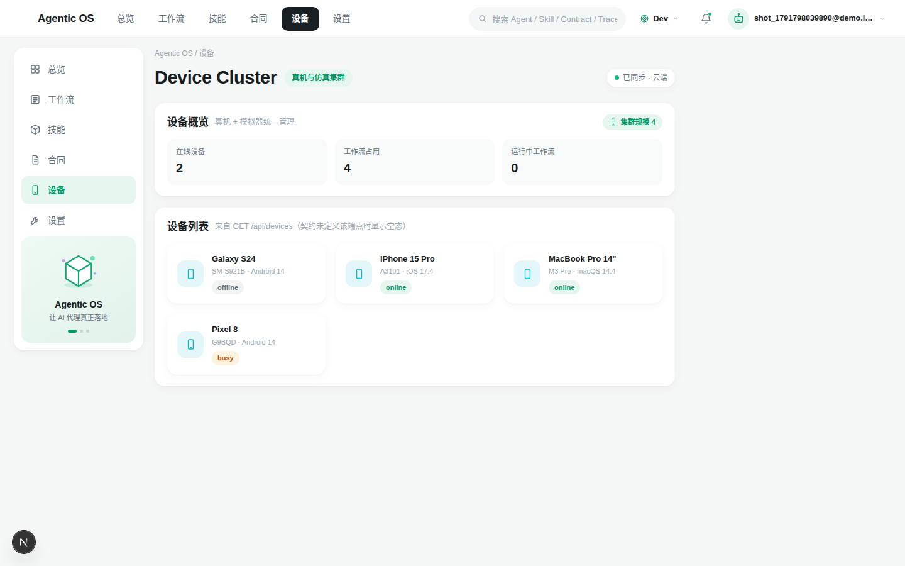
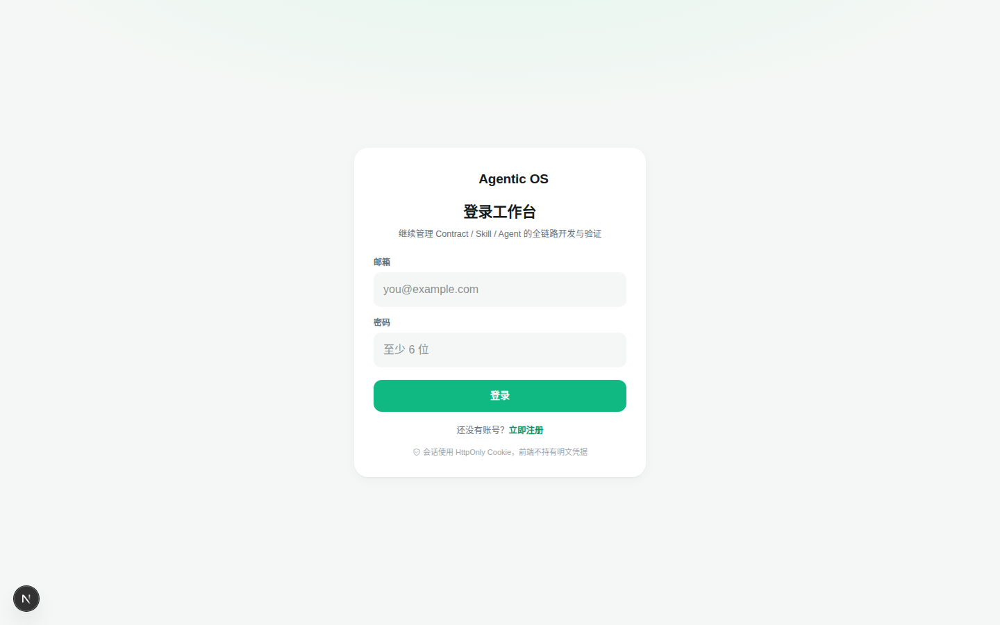

# Agentic OS 自动化开发工作台

> 面向「人 + Agent 协作开发」的端到端工作台 · **前后端分离 · 可本地部署 · 可商业化**
> Next.js 16 + React 19 + Tailwind v4 ｜ 无框架 REST 后端 ｜ JWT + HttpOnly Cookie ｜ 多租户 · 配额 · 审计 · AI 流式对话



---

## 这是什么

一个把 Agent 自动化开发「可见、可控、可交付」的控制中枢。围绕七大核心矛盾
（意图模糊 vs 执行精确、上下文膨胀 vs 记忆有限、自由生成 vs 合同约束、
单体智能 vs 多智能体协同、模拟环境 vs 真实发布、人机信任鸿沟、迭代速度 vs 质量管控）构建。

**它不是演示页面**：具备真实账号体系、服务端持久化、多租户隔离、配额计费、审计日志、
AI 流式对话。页面上每一个业务数字都来自服务端接口，不是前端写死的。

**它能跑在最简环境**：`node scripts/start-local.mjs` 一条命令启动，
不需要云平台、不需要登录、不需要联网。

---

## 页面预览

| 总览 Dashboard | AI Copilot 流式对话 |
|---|---|
|  |  |

| 工作流 | 技能 |
|---|---|
|  |  |

| 合同登记 | 设备集群 |
|---|---|
|  |  |

| 登录页 |
|---|
|  |

> 截图由 `node scripts/capture-screenshots.mjs` 从**真实运行的系统**自动截取
> （自动注册演示账号 → 登录 → 逐页截图 → 触发一次 AI 流式对话）。

---

## 架构：同仓库逻辑分离 + 双形态部署

**源码态关注点分离，部署态自包含，业务代码零平台依赖。**

```
源码态                                    部署态（同一套业务代码）
├── frontend/   Next.js 16 前端      ┌──▶ A. 本地最小化（推荐）
├── backend/    REST API 业务逻辑     │      Node HTTP :8787
│   ├── functions/  路由 + 业务       │      + 本地 JSON 文件
│   ├── lib/        领域逻辑          │      零框架 · 零平台 SDK
│   └── adapter/    Node 适配器       │
├── shared/     前后端共享契约        └──▶ B. EdgeOne Makers（可选）
├── agents/     AI Agent                   Cloud Functions /api/*
├── cloud-functions/  平台入口              + KV / Blob
└── scripts/build-deploy.mjs  →  dist/ 自包含部署单元
```

### 关键设计：三个抽象层让平台变得可替换

| 抽象 | 接口 | 实现 |
|---|---|---|
| 存储 | `StoreDriver`（get/put/del/list） | KV → Blob → **本地文件**（前者失效自动兜底） |
| 配置 | `Env` | `context.env` → `process.env` |
| 运行时 | `handleRequest(ApiCtx)` | `adapter/node.ts`（Node）｜ `cloud-functions/`（EdgeOne） |

> **业务代码（`functions/` + `lib/`）里没有一行平台专属逻辑。**
> 平台差异全部收敛在 `adapter/` 与 `cloud-functions/` 两处薄壳中。
> 因此去平台化时只新增了一个存储驱动实现，上层代码零改动。

### 为什么不直接上框架

整个 API 只有 18 条路由、7 个业务模块。手写路由表（`route(method, path, handler)`
+ 冒号参数匹配）不到 40 行，省掉一层依赖与冷启动开销；
handler 入参是自定义的 `ApiCtx`，与任何框架解耦——这正是能同时跑在
Node 与 Cloud Functions 上的前提。

详见 [docs/02-架构设计](./docs/02-架构设计.md)。

---

## 核心能力

| 领域 | 实现 |
|---|---|
| 账号体系 | bcrypt(cost 10) + JWT(jose/HS256) + HttpOnly Cookie；Cookie 优先、Bearer 兜底；服务端会话表支持主动失效 |
| 多租户隔离 | 所有业务数据以 `uid` 为前缀，**uid 由服务端从会话解出**，客户端传入的 id 只能作为末段，无法越权 |
| 持久化 | KV → Blob → 本地文件三级；**禁止内存态**（进程重启不丢数据） |
| 业务资源 | 工作流 CRUD（五端点）、Trace 写入/查询、技能、合同、设备 |
| 配额计费 | free 100 runs/月、pro 10000 runs/月，超额 402 `QUOTA_EXCEEDED` |
| 审计日志 | 关键写操作全量留痕；前端告警卡片复用同一份数据 |
| AI Copilot | SSE 流式、逐 token 打字机、可中断、配额/鉴权/上游三类错误分别处理；支持本地模拟流离线验证 |
| 前端体验 | Design Tokens 一比一复刻设计稿、内联 SVG 图标体系、五断点响应式 |

### 纯展示 vs 真实数据

| 数据 | 来源 |
|---|---|
| KPI（合同 / Skills / 设备 / 运行中测试） | `/api/contracts` `/api/skills` `/api/devices` `/api/workflows` **真实计数** |
| 趋势百分比、P95 耗时 | 由 `/api/traces` 的历史序列**真实计算**（新半段均值 vs 旧半段均值） |
| 链路记录、告警列表、用量、配额 | `/api/traces` `/api/audit` `/api/usage` |
| 端侧指标（Memory / NPU / Power） | 浏览器内演示态（服务端无数据源），UI 上明确区分 |

---

## 快速开始

### A. 本地一键启动（推荐 · 零门槛）

前置条件只有一个：**安装 [Node.js ≥ 20.9](https://nodejs.org/zh-cn)（LTS）**。不需要数据库、不需要云账号、不需要联网。

```bash
git clone https://github.com/xiaopengs/agentic-os-workbench.git
cd agentic-os-workbench
node scripts/start-local.mjs
```

脚本会**自动完成一切**：检测 Node 版本 → 首次自动安装依赖（约 1-2 分钟，仅一次）→ 启动服务 → 自动打开浏览器。

| 服务 | 地址 |
|---|---|
| 前端应用 | http://127.0.0.1:3737 |
| 后端 API | http://127.0.0.1:8787/api |

- 数据落在 `./.data/store.json`（纯文本，可直接查看 / 编辑，删除即重置）
- **无需登录、无需联网、无需 EdgeOne**；AI Copilot 默认走本地模拟流
- 停止：`Ctrl+C`（两个子进程一并退出）
- 端口可用 `API_PORT` / `WEB_PORT` 覆盖；`NO_OPEN=1` 关闭自动打开浏览器
- 首次打开前端需编译约 20-40 秒，属正常现象

> 已装好依赖时脚本秒级启动，跳过安装步骤。

### B. 单端口自包含部署（生产形态，推荐用于托管 / 容器）

前端页面与后端 API 合并进**同一个进程、同一个端口（默认 3737）**：

```bash
npm run build:app                # 生成 app-dist/：依赖已内置、.env（含随机 JWT_SECRET）已自动生成
cd app-dist && npm start         # 监听 0.0.0.0:3737（PORT 可覆盖）
```

- 唯一入口 `server.mjs`：`/api/*` → 后端，其余 → Next 生产产物；前后端同源，无 CORS
- ⚠️ 切勿在 `app-dist/` 内裸 `npm install`（会破坏 standalone 的裁剪版 next），详见 [docs/07](./docs/07-本地部署与去平台化.md)

### C. 部署到 EdgeOne Makers（可选）

```bash
npm install -g edgeone@latest --registry=https://registry.npmmirror.com
edgeone login --site china --local
node scripts/build-deploy.mjs          # 生成自包含部署单元 dist/
cd dist && npm install
edgeone makers deploy -n <项目名> --json
```

**必配环境变量**：`JWT_SECRET`（缺失直接 500 `SERVER_MISCONFIG`——**故意如此，杜绝硬编码密钥上线**）。
`AI_GATEWAY_API_KEY` / `AI_GATEWAY_BASE_URL` 由平台自动注入，自托管时自填。

完整说明见 [docs/06-部署指南](./docs/06-部署指南.md) 与
[docs/07-本地部署与去平台化](./docs/07-本地部署与去平台化.md)。

---

## API 契约

```
POST   /api/auth/register     POST /api/auth/login    POST /api/auth/logout   GET /api/auth/me
GET    /api/workflows         POST /api/workflows
GET    /api/workflows/:id     PATCH /api/workflows/:id  DELETE /api/workflows/:id
GET    /api/traces            POST /api/traces
GET    /api/skills            GET /api/contracts       GET /api/devices
GET    /api/usage             GET /api/audit           GET /api/health
POST   /api/ai/copilot        ← SSE 流式
```

**统一信封**：

```ts
type ApiResp<T> = { ok: true; data: T } | { ok: false; error: { code: string; message: string } }
```

**错误码**：`VALIDATION_ERROR`(400) · `UNAUTHORIZED`(401) · `QUOTA_EXCEEDED`(402) ·
`NOT_FOUND`(404) · `CONFLICT`(409) · `SERVER_MISCONFIG`(500) · `AI_UNAVAILABLE`(503)

**鉴权请求顺序（固定）**：`鉴权 → 校验 → 配额 → 业务 → 审计`。
AI 流式接口例外，顺序为 `Gateway 预检 → 配额 → 开流`——配额必须在 HTTP 200 提交前拦截，
否则 SSE 一旦开始就无法再用 402 表达超额。

---

## 测试

```bash
# 1) 启动本地服务
node scripts/start-local.mjs

# 2) 后端冒烟（独立进程，脱离平台可跑）
npm run test:api

# 3) 端到端（真实 Chromium）
node tests/e2e.mjs http://127.0.0.1:3737 http://127.0.0.1:8787/api

# 4) 类型门禁
npm run typecheck:backend

# 5) 生成 README 截图
node scripts/capture-screenshots.mjs http://127.0.0.1:3737 http://127.0.0.1:8787/api
```

| 套件 | 用例数 | 结果 |
|---|---|---|
| 后端冒烟（mock 存储驱动，跑真实业务逻辑） | 34 | ✅ 34/34 |
| 端到端（真实浏览器全链路） | 22 | ✅ 22/22 |
| 类型门禁 + 前端构建 | 9 条路由 | ✅ 全绿 |

端到端覆盖：未登录拦截 → 401 → 注册 201 → 弱密码 400 → 重复注册 409 → 登录 →
创建工作流 → 持久化校验 → 更新生效 → Trace 写入 → 用量接口 → 审计有记录 →
删除 → 删除后不可见 → 无效 token 401 → 登出后 401 → 零 JS 错误。

> 两个套件都**不依赖任何云平台**，因此每次改动都能立刻本地验证。
> 详见 [docs/04-测试报告](./docs/04-测试用例与对比修正报告.md) §9。

---

## 目录结构

```
agentic-os-workbench/
├── frontend/                    # Next.js 16 前端（可独立构建）
│   ├── app/                     #   App Router：(workbench)/ 路由组 + login/register
│   ├── components/              #   layout / dashboard / aside / modals / ui / icons
│   └── lib/                     #   api-client / hooks(SWR) / auth / nav / simulation
├── backend/                     # REST API 业务逻辑（零平台依赖）
│   ├── functions/               #   router + 7 个业务模块（18 条路由）
│   ├── lib/                     #   kv / store / auth / quota / audit / validate / sse / ai-gateway
│   └── adapter/                 #   node.ts（Node 运行时适配）/ server.ts（本地入口）
├── shared/types.ts              # 前后端共享契约（唯一事实源）
├── agents/copilot/              # AI Agent 运行时入口
├── cloud-functions/             # EdgeOne 平台入口（薄转发，可选）
├── scripts/                     # build-deploy / start-local / gh-push / capture-screenshots
├── tests/                       # api-smoke.ts（34 项）· e2e.mjs（22 项）
├── docs/                        # 01-07 工程文档 + screenshots/
└── workbench.html               # 原型阶段产物（设计基准，已归档）
```

---

## 文档

| 文档 | 内容 | 状态 |
|---|---|---|
| [01-需求拆解](./docs/01-需求拆解与需求文档.md) | 七大矛盾 → 能力域映射、FR 规格、分期方案 | 原型阶段（含 Phase 1 增补） |
| [02-架构设计](./docs/02-架构设计.md) | **当前架构**：分层、存储抽象、请求生命周期、安全、测试架构 | **当前有效** |
| [03-方案设计](./docs/03-方案设计.md) | **当前方案**：设计令牌、逐区域实现、前后端实现方案 | **当前有效** |
| [04-测试报告](./docs/04-测试用例与对比修正报告.md) | 原型阶段 72 项对比修正 + **Phase 1 的 56 项自动断言** | 含当前结果 |
| [05-架构选型](./docs/05-商业化架构选型与技术方案.md) | 三方案对比、技术栈、KV 设计、API 契约、商业化矩阵 | **当前有效** |
| [06-部署指南](./docs/06-部署指南.md) | EdgeOne 构建、环境变量、预览、上线、回滚、排障 | 可选路径 |
| [07-本地部署与去平台化](./docs/07-本地部署与去平台化.md) | 去平台化拆解、本地部署、自托管进阶 | **当前有效** |

---

## 路线图

- **已完成**：账号体系、多租户持久化、配额计费、审计日志、AI Copilot 流式对话、
  本地最小化部署、56 项自动测试
- **下一步**：订阅支付接入（Pro 升级）、团队协作与角色权限、Trace 回放与回归对比、
  可替换存储驱动（SQLite / Postgres）、列表分页

---

私有项目，仅授权账号内使用。
